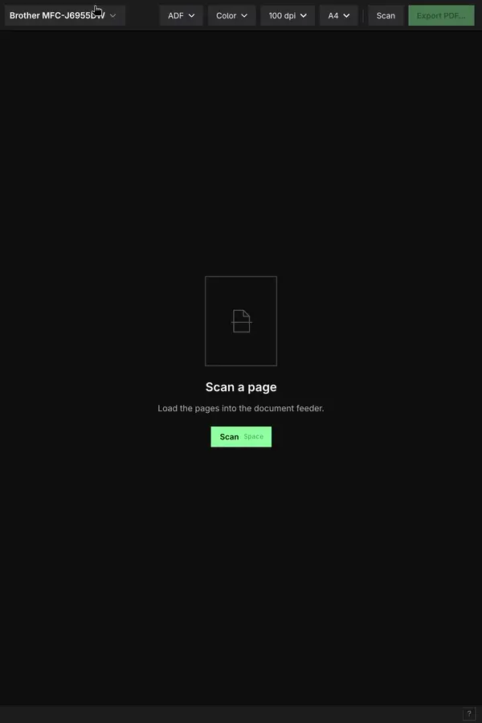
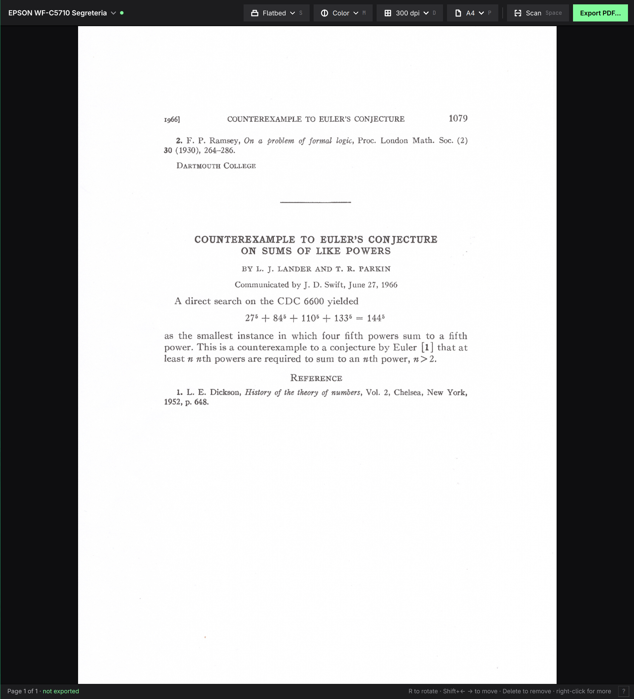

# Omascan

Scan paper to PDF from a SANE scanner, on Omarchy.



Pick the scanner, press Space, and the pages appear as they come off the
glass or out of the feeder. Turn, reorder or drop them, then export one PDF.
Omascan follows the Omarchy theme and language as they change, and is laid
out like Signed, Omarchy's PDF signer, so the two work the same way.

It drives SANE's `scanimage` rather than linking SANE, so a misbehaving
scanner driver can only end its own scan, never the app. Driverless network
scanners (eSCL/AirScan, which most scanners from the last several years
speak) work through `sane-airscan` with no vendor driver.



## Install

Omascan is in the [AUR](https://aur.archlinux.org/packages/omascan):

```sh
omarchy-pkg-aur-add omascan   # or: yay -S omascan
```

It brings SANE and `sane-airscan` with it, which is all a network scanner
needs. For a scanner on USB, add `ipp-usb` too (`omarchy-pkg-add ipp-usb`).
Omascan then appears in the app launcher (`Super + Space`).

To install from this checkout instead, run `bin/install`.

## Scanners

Omascan doesn't talk to scanners itself: SANE does. Omascan lists what SANE
finds, offers the sources, modes, resolutions and paper sizes the scanner's
SANE driver reports, runs the scan through `scanimage`, and builds the PDF.
Finding the scanner, speaking its protocol and the quality of the image are
up to SANE and its driver for that scanner, which for most network scanners
is `sane-airscan`.

So the quickest way to tell where a problem lies is to try `scanimage` alone:

```sh
scanimage -L                                # is the scanner listed?
scanimage -d '<id from the list>' -o test.png  # does a scan work?
```

If either fails, the problem is in SANE or its driver, and is best reported
there ([sane-airscan](https://github.com/alexpevzner/sane-airscan/issues) for
most network scanners). If `scanimage` works and Omascan doesn't, that's ours:
please [report it](https://github.com/alchemy/omascan/issues/new?template=scanner-report.yml).

Tested so far, each with the SANE driver named:

| Scanner | Connection | SANE driver |
|---|---|---|
| Brother MFC-J6955DW | Network (eSCL) | sane-airscan |
| Canon PIXMA TR4755i | Network (eSCL) | sane-airscan |
| Epson WF-C5710 | Network (eSCL) | sane-airscan |

Other scanners that work with SANE should work in Omascan too. Reports of
what you tried, working or not, help grow this list.

## Keys

| Key | Does |
| --- | --- |
| `Space` | Scan, or cancel the scan |
| `Esc` | Cancel the scan |
| `Ctrl+S` | Export PDF |
| `Ctrl+N` | New document |
| `↑` `↓` or `PgUp` `PgDn` / `Home` `End` | Previous or next page / first or last |
| `Shift+↑` `Shift+↓` | Move the page |
| `R` / `Shift+R` | Rotate right / left |
| `Delete` or `X` | Delete the page |
| `Ctrl+Z` / `Ctrl+Shift+Z` | Undo / redo |
| `S` | Next source (Flatbed, ADF, ADF Duplex…) |
| `M` | Next color mode |
| `D` / `Shift+D` | Higher / lower resolution |
| `P` | Next paper size |
| `F5` | Find scanners again |
| `Ctrl+=` `Ctrl+-` `Ctrl+0` | Zoom in, out, fit (or `Ctrl` + scroll) |
| `?` | Show the shortcuts |
| `Q` | Quit (asks first if pages are not exported) |

Click a setting in the top bar for its menu, the scanner name for the other
scanners, and right-click a page for what can be done to it.

## Command line

Every command but `open` runs without a display, exits 0 or 1, prints errors
on stderr, and takes `--json`.

```sh
omascan open                       # the window
omascan devices                    # scanners SANE can reach
omascan options --device <id>      # sources, modes, resolutions
omascan scan --source ADF --resolution 300 --page a4 -o letter.pdf
omascan skill install              # teach coding agents to use omascan
```

`OMASCAN_TEST_SCANNER=1` adds SANE's built-in test scanner to the list, for
working without hardware.

## Develop

```sh
bin/build && build/omascan open
bin/test
```

Scans live in `~/.cache/omascan/session-*` while the window is open and are
removed when it closes. The originals are never changed: rotation and order
are applied only when the PDF is written, and the PDF is written beside its
target and renamed into place.

## License

MIT. Theme, translation, portal, command line and window patterns come from
Omacut, Monologue, Hype and Signed by David Heinemeier Hansson, also MIT.
